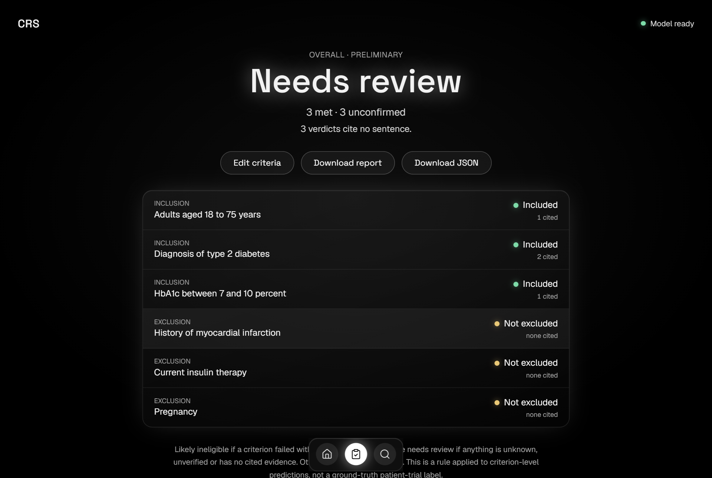
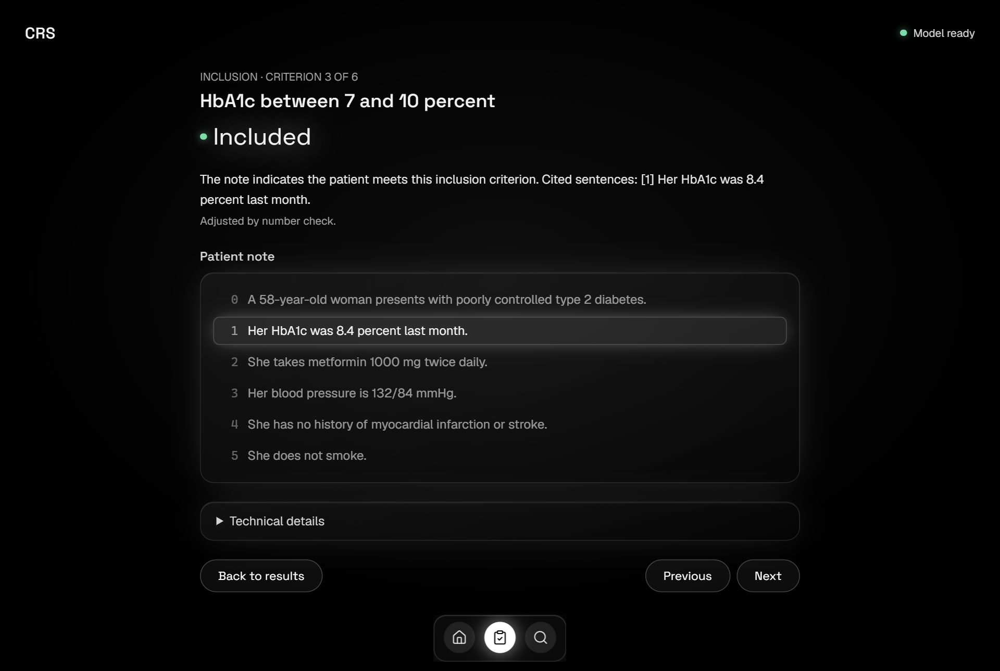
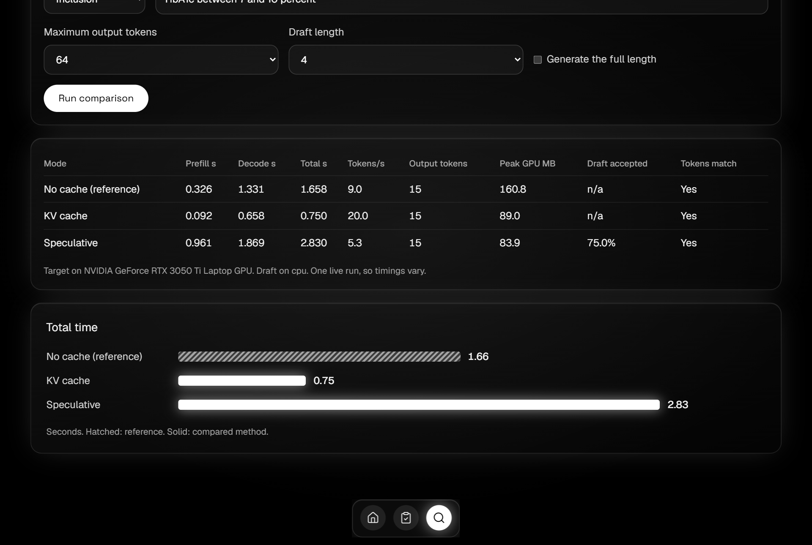

<p align="center">
  
</p>

<h1 align="center">CRS</h1>
<p align="center"><strong>Clinical Records Screener</strong></p>
<p align="center">Check a patient note against a clinical trial's eligibility criteria, one criterion at a time, with the evidence shown for every verdict. It runs entirely on your own machine.</p>

<p align="center">
  
</p>

> **Research prototype.** CRS is an educational screening tool and isn't a clinical enrollment decision. Its verdicts can be wrong, including ones that cite evidence, so a qualified person has to check them. Don't use it for patient care.

## What it does

Paste or upload a patient note, add the trial's inclusion and exclusion criteria, and CRS returns a verdict for each criterion along with the exact note sentences it relied on.

- **Label for every criterion.** Included, not included, excluded, not excluded, not enough information, or not applicable. Unknown and not-applicable stay separate, so a silent note doesn't turn into a false yes or no.
- **Evidence you can check.** Open any criterion to see its cited sentences highlighted in the note.
- **A cautious overall result.** A patient is only *likely ineligible* if a criterion failed with cited evidence. Anything unknown, unverified or uncited becomes *needs review*, because missing information is never treated as proof.
- **Sentence review.** Before screening, fix any sentence that was split badly by editing, splitting, merging, adding or removing it.
- **Trial import.** Enter an NCT number to pull criteria from ClinicalTrials.gov.
- **Downloadable reports.** Export a formatted HTML report or JSON, with the exact model and adapter versions recorded. Saved reports can be reopened later.
- **Live inference lab.** Compare the decoders and attention kernels on your own hardware, with real timings.
- **Works offline.** After setup, only the ClinicalTrials.gov import needs a connection. Notes stay on your machine.

<table>
  <tr>
    <td></td>
    <td></td>
  </tr>
  <tr>
    <td align="center">Evidence highlighted in the note</td>
    <td align="center">Live decoding comparison</td>
  </tr>
</table>

## Quick start (Windows)

You'll need [Python 3.11 or newer](https://www.python.org/downloads/) with "Add python.exe to PATH" ticked, and [Git](https://git-scm.com/).

```
git clone https://github.com/FaatehHaneef/Clinical-records-screener.git
```

1. Open the folder and double-click **`setup_app.bat`**. It's a one-time step that installs the packages and downloads about 4 GB of models. It picks GPU or CPU PyTorch by itself.
2. Double-click **`start_app.bat`**. Your browser opens at <http://127.0.0.1:8600> once the model has loaded.

Keep the black window open while you use the app, and close it to stop CRS.

### Hardware

| | Minimum | Tested on |
|---|---|---|
| GPU | Optional | NVIDIA GPU with 4 GB of memory |
| Memory | 8 GB free recommended without a GPU | 16 GB laptop |

With a 4 GB GPU, a screening takes seconds. Without one, six criteria take about 40 seconds if at least 8 GB of memory is free, and about 2 minutes if less is free, since the app then switches to a lower-memory mode.

The model nearly fills a 4 GB GPU, so close other programs that use it, such as games, before starting.

### Other platforms

Only Windows has been tested. On Linux or macOS the same steps should work by hand:

```bash
python -m venv .venv && source .venv/bin/activate
pip install torch==2.11.0
pip install -r requirements.txt
python scripts/fetch_resources.py --app-only
python scripts/fetch_adapters.py
python -m app.server
```

Then open <http://127.0.0.1:8600>.

## How it works

CRS is a [Qwen2.5-1.5B](https://huggingface.co/Qwen/Qwen2.5-1.5B-Instruct) model fine-tuned with LoRA on the expert labels in the [TrialGPT Criterion Annotations](https://huggingface.co/datasets/ncbi/TrialGPT-Criterion-Annotations) dataset.

1. The note is split into numbered sentences, which you can correct.
2. For each criterion, the model is asked for one JSON object holding a label and supporting sentence IDs.
3. A verifier checks the JSON, the label and that every cited sentence exists. Output that fails is reported as unverified.
4. A plain-code number check handles simple comparisons such as "BMI of at least 30", because the model is unreliable at them. Rows it changes are marked "Adjusted by number check."
5. Explanations use fixed wording that quotes the cited sentences, so they can't introduce facts of their own.
6. An explicit rule combines the verdicts into a preliminary overall result.

The inference code is written against the model's forward pass in [`screener/`](screener/), and you can pick each mode in the app:

| Mode | What it does | Measured on an NVIDIA T4 |
|---|---|---|
| KV-cached decoding | Reuses each layer's keys and values between tokens | Identical tokens, up to 8.97x faster than no cache |
| Tiled online-softmax attention | Computes attention tile by tile, never holding the full score matrix | Within about 1e-6 of the reference, 83x less GPU memory at length 4096, slower in runtime |
| Greedy speculative decoding | A 0.5B draft model proposes tokens and the target verifies them | Identical tokens, 0.51x to 0.85x of greedy speed at these model sizes |

Speculative decoding is correct, but it doesn't speed things up here, because a draft step isn't much cheaper than a target step when the target is only 1.5B.

## Accuracy

Scores on held-out patients the model never saw during training or tuning (8 patients, 206 criteria):

| | Accuracy | Macro-F1 | Evidence micro-F1 |
|---|---|---|---|
| **CRS (fine-tuned)** | **0.728** | **0.560** | **0.523** |
| Same model, untrained | 0.204 | 0.234 | 0.130 |
| Always guess the most common label | 0.626 | 0.272 | 0.000 |

These figures measure the model alone, without the number check. With only 8 test patients, the 95% range for macro-F1 is 0.43 to 0.64.

**Known limitations**

- It's a small model. It struggles with comparing numbers and with medical knowledge, such as knowing that apixaban is an anticoagulant.
- When a note says nothing about an exclusion criterion, it tends to answer "not excluded". CRS flags those rows as unconfirmed.
- A citation shows where the model looked, and doesn't prove its reasoning was right.
- The training data is small (602 rows) and some labels are rare. "Excluded" has no test examples, so it couldn't be measured.
- The number check handles only simple comparisons, and it hasn't been validated on BMI or lab values against dataset labels.

The full analysis is in [`results/error_analysis.md`](results/error_analysis.md) and the [paper](report/main.pdf).

## Configuration

The app reads these optional environment variables:

| Variable | Default | Purpose |
|---|---|---|
| `CRS_TARGET` | `models/qwen2.5-1.5b` | Target model folder |
| `CRS_ADAPTER` | `models/crs-adapter` | LoRA adapter for the target |
| `CRS_DRAFT` | `models/qwen2.5-0.5b` | Draft model folder |
| `CRS_DRAFT_ADAPTER` | `models/crs-draft-adapter` | LoRA adapter for the draft |
| `CRS_DRAFT_DEVICE` | `cpu` | Device for the draft model, such as `cuda` |
| `CRS_ORDER` | `label_first` | Output field order the adapter was trained with |

## Troubleshooting

| Problem | What to do |
|---|---|
| "The graphics card does not have enough free memory" | Close other programs that use the GPU and start CRS again |
| Windows shows "protected your PC" | Click **More info**, then **Run anyway** |
| "The model files are missing" | Run `setup_app.bat`. It keeps finished downloads if it's interrupted |
| The page doesn't open | Go to <http://127.0.0.1:8600> yourself and check the black window for errors |

## Model files

The fine-tuned adapters are published on Hugging Face, and `adapters.lock.json` pins their exact revisions:

- Target: [`faa-tehe/crs-qwen2.5-1.5b-lora`](https://huggingface.co/faa-tehe/crs-qwen2.5-1.5b-lora)
- Draft: [`faa-tehe/crs-qwen2.5-0.5b-draft-lora`](https://huggingface.co/faa-tehe/crs-qwen2.5-0.5b-draft-lora)

## Development

```
app/            FastAPI server, screening pipeline, report and number check
app/web/        React interface (prebuilt in app/web/dist)
screener/       Data, training, evaluation, decoders and attention
benchmarks/     Cache, attention and speculative benchmarks
kaggle/         Notebooks for training and the final evaluation
tests/          Automated tests
results/        Metrics, predictions, benchmark logs and error analysis
splits/         Patient split manifest
report/         Paper source and the script that builds its figures and tables
docs/           Design decisions and failures
```

Run the tests with `python -m pytest`. Some of them load the models, so finish setup first and leave the GPU free.

To change the interface you'll need Node 22. Run `npm install` and `npm run build` in `app/web`.

### Reproducing the results

The patient split is fixed in [`splits/manifest.json`](splits/manifest.json): sorted patient IDs, shuffled with `numpy.random.default_rng(42)`, then 37, 8 and 8 patients for training, validation and test.

1. **Train.** Run [`kaggle/train.ipynb`](kaggle/train.ipynb) on Kaggle with GPU and internet turned on. It runs every validation experiment and never reads the test split.
2. **Evaluate and benchmark.** Run [`kaggle/final_eval_and_benchmarks.ipynb`](kaggle/final_eval_and_benchmarks.ipynb), which uses the frozen `final-config` tag. The test split can only be read with an explicit `--final` flag, and each access is logged to `results/test_access_log.jsonl`.
3. **Rebuild the paper's figures and tables** with `python report/make_assets.py`.

Decisions, rejected options and failures along the way are recorded in [`docs/DECISIONS.md`](docs/DECISIONS.md).

## Acknowledgements

CRS builds on the [TrialGPT Criterion Annotations](https://huggingface.co/datasets/ncbi/TrialGPT-Criterion-Annotations) from NCBI and [Qwen2.5](https://github.com/QwenLM/Qwen2.5) (Apache 2.0). GPT-4 predictions in that dataset are never used. The interface adapts a dock component from [21st.dev](https://21st.dev) and uses [thinking-orbs](https://www.npmjs.com/package/thinking-orbs). The method draws on LoRA, FlashAttention, online softmax and speculative decoding, cited in the [paper](report/main.pdf).
